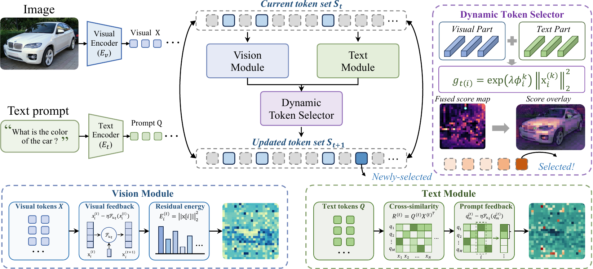

<div align="center">
  
  <h1>🤿 DIVE: Dynamic Iterative Visual Evidence Construction<br>for Efficient Vision-Language Models</h1>
</div>

> **TL;DR:** DIVE is a training-free visual-token reduction method for efficient
> vision-language models. It constructs visual evidence iteratively while
> preserving the information needed by downstream text generation.

## 🔥 News

- **`2026.08.01`** 🤗🤗 We have released DIVE, a training-free method for efficient visual-token reduction in vision-language models.
- **`2026.07.29`** 🤗🤗 The DIVE framework, LLaVA evaluation scripts, and Qwen2-VL and LLaVA-OneVision integrations are now available.

## 👀 Overview

DIVE provides a native LLaVA-1.5/1.6 language-model path using the DIVE
selector, together with Qwen2-VL and LLaVA-OneVision integrations.

<p align="center">
  
</p>

## 🛠 Preparation

### LLaVA

```bash
conda create -n DIVE python=3.10 -y
conda activate DIVE
pip install -e .
pip install flash-attn --no-build-isolation
```

Download the benchmark assets from their official sources and extract them
under `./playground/data/eval`.

### Qwen2-VL

```bash
conda create -n DIVE_Qwen2VL python=3.10 -y
conda activate DIVE_Qwen2VL
cd othermodels/qwen2_vl/transformers && pip install -e .
pip install accelerate qwen-vl-utils[decord]
pip install flash-attn --no-build-isolation
cd ../../../lmms-eval && pip install -e .
```

## 🎯 Usage

### LLaVA-1.5

```bash
bash scripts/v1_5/eval/[benchmark].sh [reduction_ratio] [max_num_trunction]
```

```bash
CUDA_VISIBLE_DEVICES=0 bash scripts/v1_5/eval/textvqa.sh 0.778 128
CUDA_VISIBLE_DEVICES=0 bash scripts/v1_5/eval/pope.sh 0.778 128
CUDA_VISIBLE_DEVICES=0 bash scripts/v1_5/eval/mme.sh 0.778 128
```

### LLaVA-NeXT

```bash
bash scripts/v1_6/eval/[benchmark].sh [reduction_ratio] [max_num_trunction]
```

```bash
CUDA_VISIBLE_DEVICES=0 bash scripts/v1_6/eval/pope.sh 0.778 128
```

### Qwen2-VL

```bash
cd othermodels/qwen2_vl
bash eval_scripts/lmms_eval.sh True [reduction_ratio]
```

### LLaVA-OneVision

The DIVE adapter is available through lmms-eval as `llava_onevision`; its
implementation is under `othermodels/llava_ov/`.

## 🔑 License

This project is released under the [Apache License 2.0](LICENSE). Original
upstream copyright and license notices are retained in the source files.

## 👍 Acknowledgment

DIVE thanks the LLaVA, Qwen2-VL, DART, and lmms-eval communities for their
open-source contributions.
